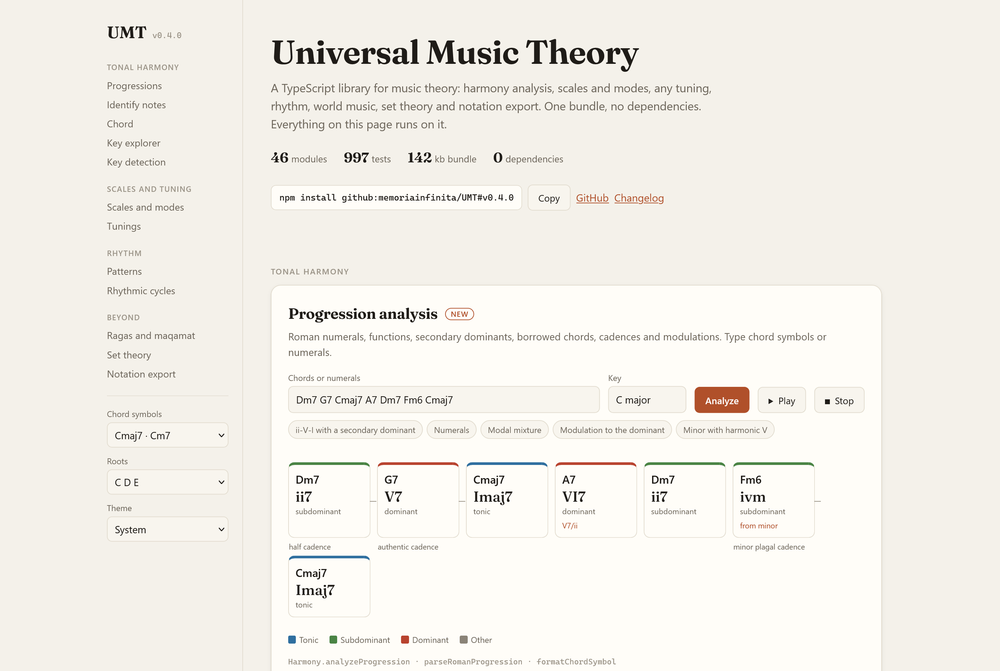
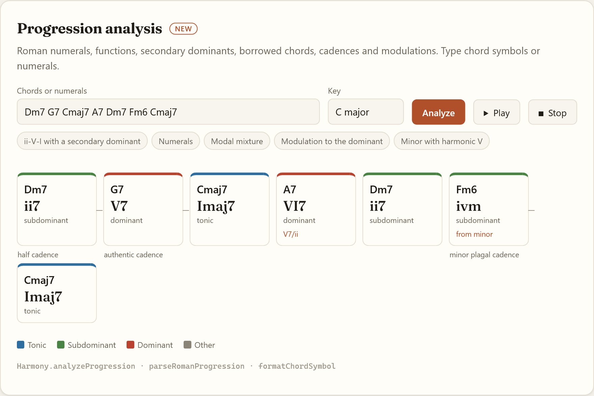
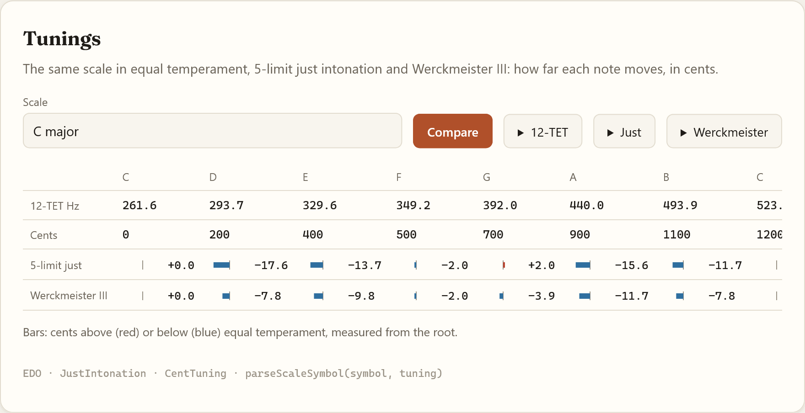
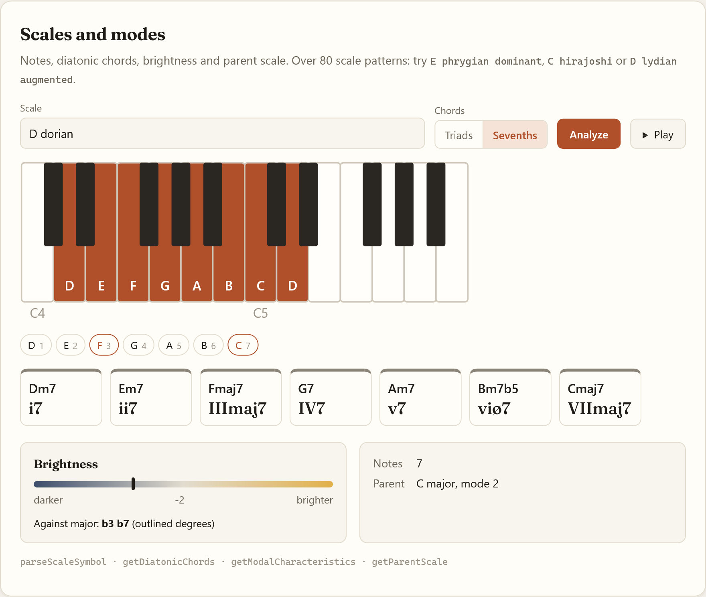
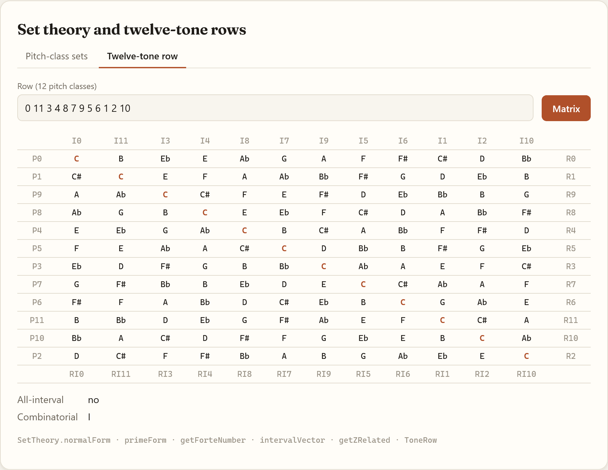
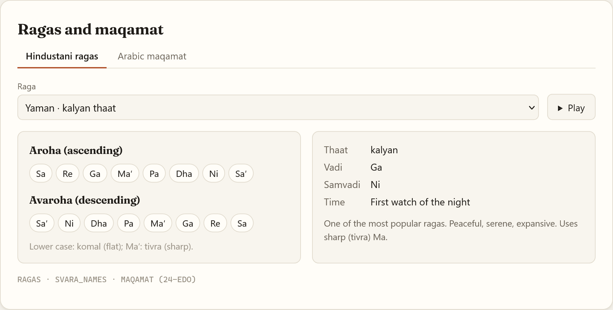
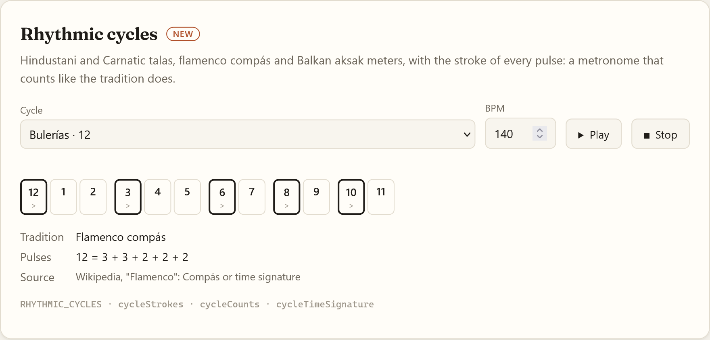
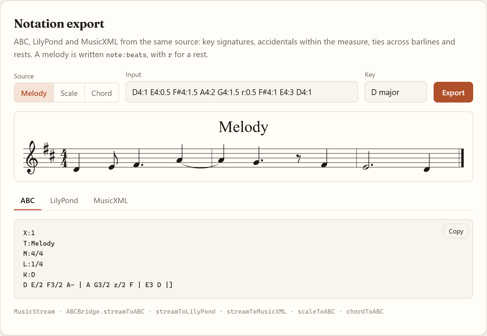

# UMT

[](https://cdn.jsdelivr.net/gh/memoriainfinita/UMT@v0.7.0/dist/umt.js)
[](https://memoriainfinita.github.io/UMT)
[](LICENSE)

A TypeScript library for music theory computation that works across any tuning system -
12-TET, microtonal, historical temperaments, world music traditions, and post-tonal systems.
Zero runtime dependencies. 152 kb compiled bundle (IIFE), plus an ESM build with bundled types.

**[Live demo](https://memoriainfinita.github.io/UMT)** · **[Developer guide](GUIDE.md)** · **[API docs](https://memoriainfinita.github.io/UMT/api-docs/)** · **[Contributing](CONTRIBUTING.md)**



---

## What it does

Most music theory libraries are hardcoded to 12-TET. UMT is built around a `TuningSystem`
abstraction: a chord, scale or progression in 31-EDO, just intonation or Werckmeister III is
named and analysed as in 12-TET, and sounds at that tuning's pitches. Systems with a theory of
their own (maqamat, ragas, Bohlen-Pierce, xenharmonic scales) have their own modules. The
guide's [Other tunings](GUIDE.md#other-tunings) says what holds where.

```typescript
// Same chord, three tuning systems
const cmaj = parseChordSymbol('C major', TET12);
const cmaj_ji = parseChordSymbol('C major', PtolemaicJI);
const cmaj_werck = parseChordSymbol('C major', WerckmeisterIII);

// Ragas and maqamat with quarter-tone accuracy
const bhairav = RAGAS['bhairav'];    // aroha, avaroha, vadi, samvadi
const rast = MAQAMAT['rast'];        // 24-EDO quarter-tone intervals

// Post-tonal analysis
const row = new ToneRow([0, 11, 3, 4, 8, 7, 9, 5, 6, 1, 2, 10]);
const matrix = row.getMatrix();      // 12x12 P/I/R/RI matrix

// Set theory with Forte catalogue
SetTheory.getForteNumber([0, 3, 6, 9]);   // "4-28"
SetTheory.getZRelated([0, 1, 4, 6]);      // Z-related sets
```

---

## Installation

Releases are git tags (`v0.7.0`); pin one, since `main` may change. Breaking changes are listed in `CHANGELOG.md`.

**Browser - CDN (jsDelivr)**
```html
<script src="https://cdn.jsdelivr.net/gh/memoriainfinita/UMT@v0.7.0/dist/umt.js"></script>
<script>
  const chord = UMT.parseChordSymbol('Cmaj9');
  console.log(chord.getNotes().map(n => n.name));
</script>
```

**Browser - local**
```html
<script src="umt.js"></script>
```

**pnpm (from GitHub) - ESM with types**
```bash
pnpm add github:memoriainfinita/UMT#v0.7.0
```
```typescript
import { parseChordSymbol, TET12, Harmony, SetTheory } from 'universal-music-theory-library';
```

**Browser - ESM from the CDN**
```html
<script type="module">
  import { parseChordSymbol } from 'https://cdn.jsdelivr.net/gh/memoriainfinita/UMT@v0.7.0/dist/umt.mjs';
</script>
```

**Build from source**
```bash
pnpm install
pnpm run build   # dist/umt.js (IIFE), dist/umt.mjs (ESM), dist/umt.d.ts (types)
```

---

## Modules

### Core

| Module | What it does |
|--------|-------------|
| `tuning.ts` | `EDO`, `JustIntonation`, `CentTuning`, `NonOctaveTuning` - the universal tuning abstraction |
| `note.ts` | Pitch as frequency, MIDI, and enharmonic name in any tuning |
| `interval.ts` | Interval math in cents and ratios |
| `parser.ts` | `parseChordSymbol`, `parseScaleSymbol`, `parseNote`, `parseRomanProgression` - all tuning-aware |
| `aliases.ts` | `translateSymbol`: chord and scale names in Spanish, French and Italian (`'Sib menor'` → `'Bb minor'`) |
| `dictionaries.ts` | 100+ chord formulas, 80+ scale patterns |
| `presets.ts` | Ready-to-use tuning systems, scales, chords |
| `utils.ts` | MIDI conversion, enharmonic spelling, interval naming |
| `fretboard.ts` | Chord voicings and scale positions on any fretted instrument; guitar, bass, ukulele and banjo tunings |

### Tonal harmony

| Module | What it does |
|--------|-------------|
| `harmony.ts` | Voice leading, chord detection, negative harmony, cadences, borrowed chords, modal interchange, Coltrane axis |
| `chord.ts` | Voicings (drop2, drop3, quartal, rootless), inversions, tritone substitution, smooth transitions |
| `scale.ts` | Modes, diatonic chords, brightness, avoid notes, parent scale navigation |
| `circle.ts` | Circle of fifths - key signatures, relatives, neighbors, modal distance |
| `substitution.ts` | Chord substitutions (tritone, sus4, deceptive, diatonic) |
| `progressions.ts` | 16 named progressions (ii-V-I, Coltrane changes, blues 12, rhythm changes...) |
| `form.ts` | Formal analysis - AABA, ABAB, binary, ternary, through-composed |
| `upper-structures.ts` | Upper structure triads, slash chord analysis, chord-scale completeness |
| `key-detection.ts` | Correlation key finding with five key profiles (Krumhansl-Kessler, Aarden-Essen, Bellman-Budge, Temperley-Kostka-Payne, simple) |
| `neo-riemannian.ts` | P, L, R transformations in any tuning |
| `figured-bass.ts` | Figured bass parsing and realization |
| `spelling.ts` | Pitches spelled in a key (harmonic chromatic scale), chord tones by interval |
| `voicing.ts` | Voicing analysis: inversion, close/open position, drop 2/3/2+4, doubled, omitted and added notes |
| `scale-finder.ts` | Every scale of the dictionary, on every root, that holds a set of notes, ranked |
| `chord-names.ts` | Chord symbol styles (Cmaj7 / CΔ7 / CM7), solfège roots; chord, scale, cadence and substitution names in English and Spanish |

### Post-tonal

| Module | What it does |
|--------|-------------|
| `set-theory.ts` | Normal/prime form, interval vector, Forte catalogue (223 set classes), Z-relations, Tn/TnI |
| `twelve-tone.ts` | Tone rows, P/I/R/RI forms, 12x12 matrix, all-interval and combinatorial detection |
| `counterpoint.ts` | Species counterpoint checker, Canon |
| `schenker.ts` | Basic Schenkerian reduction |
| `melody.ts` | Contour analysis, motif detection |

### World music

| Module | What it does |
|--------|-------------|
| `ragas.ts` | 10 Hindustani ragas - aroha, avaroha, vadi, samvadi, time, description |
| `maqamat.ts` | 8 Arabic maqamat in 24-EDO quarter-tone intervals |
| `solfege.ts` | Fixed-do and movable-do solfege |
| `hexachord.ts` | Guidonian hexachord system |

### Rhythm

| Module | What it does |
|--------|-------------|
| `rhythm.ts` | Euclidean rhythms, polyrhythm, metric modulation, isorhythm |
| `clave-patterns.ts` | 10 clave presets (son, rumba, bossa nova, tresillo, habanera...) |
| `rhythmic-cycles.ts` | Hindustani and Carnatic talas, flamenco compás (bulerías, soleá, seguiriya), aksak meters |

### Microtonal / Xenharmonic

| Module | What it does |
|--------|-------------|
| `scala.ts` | Scala `.scl` file parser |
| `tonnetz.ts` | Tonnetz pitch space - position and navigation |
| `mos.ts` | Moment of Symmetry scales, MOS families, comma pumps |
| `xen.ts` | Otonal/utonal series, neutral intervals |
| `spectral.ts` | Roughness (Plomp-Levelt), sensory consonance, overtone series |
| `temperament-analysis.ts` | Temperament error analysis, EDO comparison, JI mapping |
| `voice-leading-geometry.ts` | OPTIC equivalences, efficient voice leading geometry (Tymoczko) |

### Notation

| Module | What it does |
|--------|-------------|
| `abc-bridge.ts` | Export scales, chords, and streams to ABC notation |
| `lilypond-bridge.ts` | Export scales, chords, and streams to LilyPond |
| `musicxml-bridge.ts` | Export scales, chords, and streams to MusicXML |
| `notation-layout.ts` | Shared by the exporters: spelling, key signatures, measures, ties and triplets |

---

## Examples

### Harmony analysis



```typescript
import { parseChordSymbol, Harmony, getSubstitutions } from './lib/music-theory';

const chords = ['Dm7', 'G7', 'Cmaj7', 'A7', 'Dm7', 'Fm6', 'Cmaj7'].map(s => parseChordSymbol(s));
const { analysis } = Harmony.analyzeProgression(chords, 'C major');
analysis.map(a => a.roman);
// ['ii7', 'V7', 'Imaj7', 'VI7', 'ii7', 'ivm', 'Imaj7']
analysis[3].secondaryTarget;   // 'V7/ii'
analysis[5].borrowedFrom;      // 'minor'
analysis[1].cadenceWithNext;   // 'Authentic Cadence (V -> I)'

const g7 = parseChordSymbol('G7');
Harmony.getSuggestedScales(g7)[0];
// { scale: 'G mixolydian', hint: 'standard V' }
getSubstitutions(g7, 'C major').map(s => `${s.chord.name} (${s.type})`);
// ['Db7 (tritone)', 'Gsus4 (sus4)', 'Am (deceptive)', 'Bm7b5 (diatonic)']

Harmony.getColtraneAxis('C major');
// { root: 'C', majorThirds: ['C', 'E', 'Ab'] }
```

Names for an interface in English or Spanish:

```typescript
import { formatChordSymbol, chordLongName, scaleName, cadenceName, substitutionTypeName } from './lib/music-theory';

formatChordSymbol('F#m7b5', { style: 'symbols', roots: 'solfege' });  // 'Fa#ø7'
chordLongName('F#m7b5', 'es');                                        // 'Fa sostenido semidisminuido'
scaleName('G mixolydian', 'es');                                      // 'Sol mixolidio'
scaleName(analysis[5].borrowedFrom, 'es');                            // 'menor'
cadenceName(analysis[1].cadenceWithNext, 'es');                       // 'Cadencia auténtica (V -> I)'
cadenceName(analysis[1].cadenceWithNext, 'es', { short: true });      // 'Auténtica'
substitutionTypeName('tritone', 'es');                                // 'tritonal'
```

### Tuning



### Modal analysis



```typescript
import { parseScaleSymbol } from './lib/music-theory';

const scale = parseScaleSymbol('D dorian');

scale.getDiatonicChords('seventh');
// [Dm7, Em7, Fmaj7, G7, Am7, Bm7b5, Cmaj7]

const modal = scale.getModalCharacteristics();
// { brightness: -2, characteristicIntervals: ['b3', 'b7'] (against major), parentModeDegree: 2, ... }

scale.getParentScale();   // C major
scale.getRelativeMode('lydian');  // F lydian
```

### Twelve-tone row



```typescript
import { ToneRow } from './lib/music-theory';

const row = new ToneRow([0, 11, 3, 4, 8, 7, 9, 5, 6, 1, 2, 10]);

row.P(0);   // prime form
row.I(0);   // inversion
row.R();    // retrograde
row.RI(0);  // retrograde inversion

row.getMatrix();        // 12x12 transformation matrix
row.isAllInterval();    // true if all 11 intervals are distinct
row.isCombinatorial();  // combinatoriality check
row.getHexachords();    // [first6, last6]
```

### World music



```typescript
import { RAGAS, MAQAMAT, CLAVE_PATTERNS } from './lib/music-theory';

// Hindustani raga
const bhairav = RAGAS['bhairav'];
bhairav.aroha;      // ascending scale in semitones
bhairav.vadi;       // primary note, a svara number (SVARA_NAMES[6] = 'Dha')
bhairav.time;       // 'Early morning'

// Arabic maqam (24-EDO quarter-tones)
const rast = MAQAMAT['rast'];
rast.notes;         // interval pattern in quarter-tones
rast.ajnas;         // constituent tetrachords

// Clave rhythm
const clave = CLAVE_PATTERNS['son-3-2'];
clave.steps;        // boolean[16] - onset pattern
```

### Rhythm



```typescript
import { RHYTHMIC_CYCLES, cycleCounts, cycleStrokes, Polyrhythm } from './lib/music-theory';

const bulerias = RHYTHMIC_CYCLES.bulerias;
cycleCounts(bulerias);    // [12, 1, 2, 3, ... 11]
cycleStrokes(bulerias);   // ['accent', 'beat', 'beat', 'accent', ...]
cycleStrokes(RHYTHMIC_CYCLES.teental)[8];   // 'khali'

Polyrhythm.euclidean(5, 8);   // [true, false, true, true, false, true, true, false]
```

### Notation export



```typescript
import { parseScaleSymbol, ABCBridge, scaleToLilyPond, scaleToMusicXML } from './lib/music-theory';

const scale = parseScaleSymbol('D dorian');

ABCBridge.scaleToABC(scale, 1, 'D dorian');   // ABC notation, accidentals against K:Ddor
scaleToLilyPond(scale);            // LilyPond source
scaleToMusicXML(scale);            // MusicXML document
```

---

## Architecture

**Coordinate system:** all pitch positions are steps from A4 = 0. A4 = 440 Hz = step 0. C4 = -9 in 12-TET.

**Tuning abstraction:** `parseChordSymbol`, `parseScaleSymbol`, and `parseRomanProgression` accept an optional `TuningSystem` parameter (default: `TET12`). Interval values from the dictionaries are mapped to the target tuning via `tuning.getStepFromStandard()`.

**Enharmonic spelling:** the library uses circle-of-fifths logic to choose flats vs. sharps - not a hardcoded list. `preferFlats` is stored per `Note` and propagated through all transformations. Interval-based overrides ensure m3, m7 etc. are always spelled as flat-side intervals regardless of key. Heptatonic scales are spelled one letter per degree, so F# major contains E# and D harmonic minor contains C#; their diatonic chords take the same letters (`E#dim`).

---

## Tests

```bash
pnpm run test:unit    # 1315 unit tests via vitest: one file per module, plus the tuning conformance battery
pnpm run typecheck    # TypeScript type checking
```

---

## License

GPL-3.0. Created for people, not for corporate profit. Any software using this library must also remain free and open. See `LICENSE`.

## Credits

Developed by [@memoriainfinita](https://github.com/memoriainfinita) with the assistance of Claude (Anthropic): Opus 4.8, Sonnet 4.6 and Fable 5.
